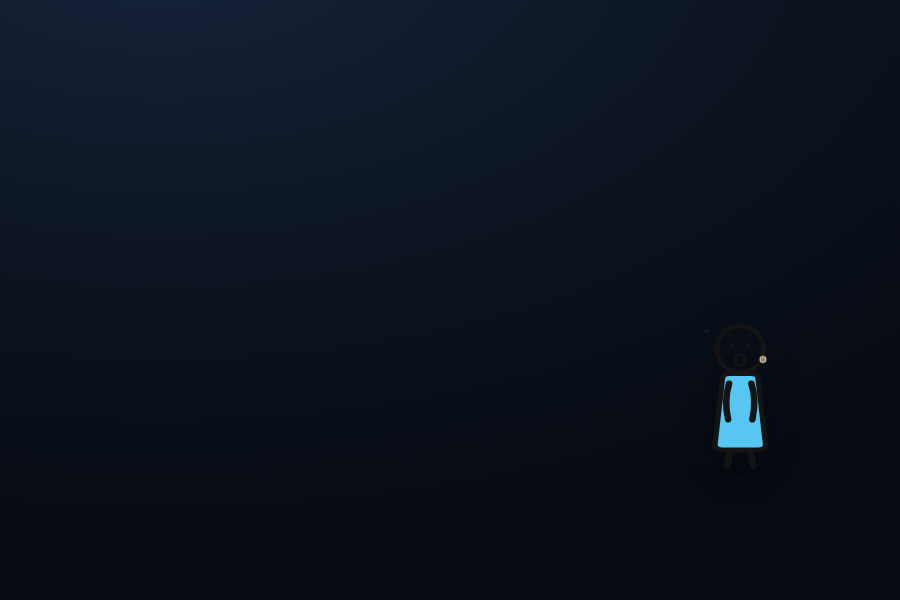
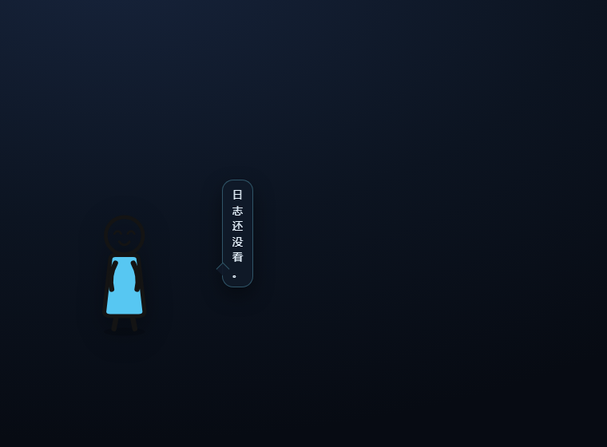
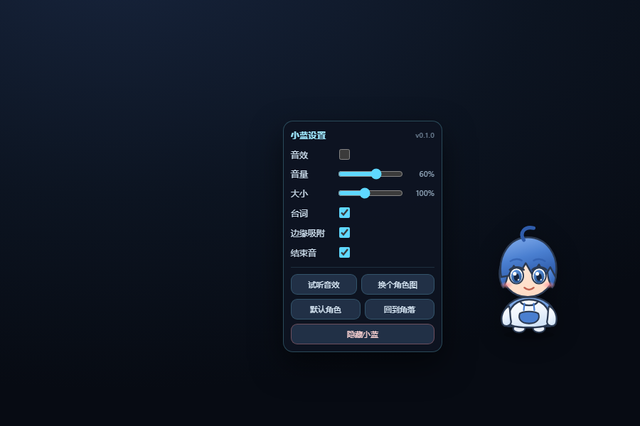
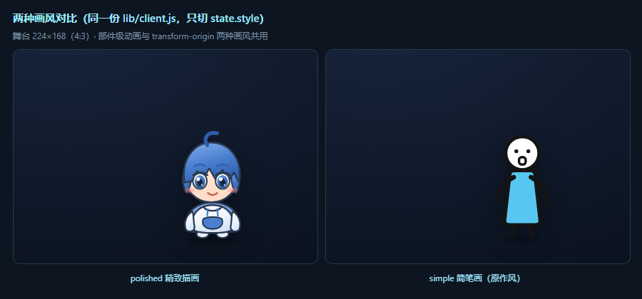
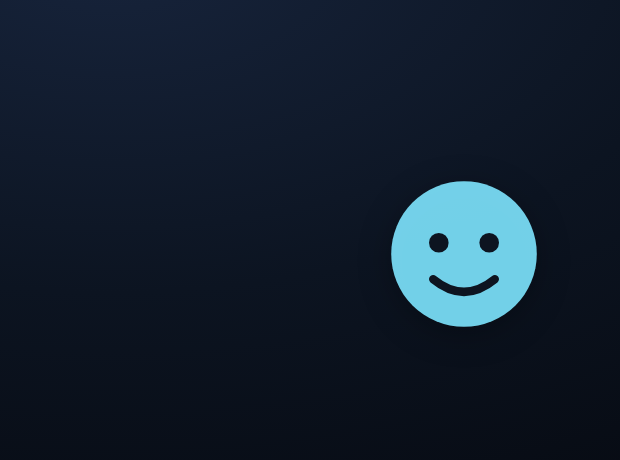

# handsomeFish · DSH 桌面宠物挂件（小蓝）

> 住在 DeepSeek Harness 界面角落的**小蓝**（《小绿和小蓝》· 机器人篇的程序员/发明家）：
> 程序化 SVG 角色 + 部件级待机动画 + 点击互动 + 拖拽边缘吸附 + 随机台词气泡 + Web Audio 程序化合成音效。
> 标准 DSH bundle 插件，`dsh plugin` 一键安装，**零素材依赖、零网络请求**。
> 角色形象来自笛子Ocarina 的《小绿和小蓝》。
>
> **📚 文档索引**：[技术文档](docs/architecture.md)（架构 / 平台 API / 数据流 / 验证体系 / 踩坑清单）·
> [角色考证](docs/xiaolan.md) · [素材规格](docs/asset-checklist.md) ·
> [素材收件规范](docs/asset-intake.md)（你怎么把图片信息给我，我按它生产）·
> [AI 生图提示词](docs/character-spec.md) · [桌面外壳](desktop/README.md)



---

## 一、这是什么（以及不是什么）

| | |
|---|---|
| ✅ 是 | **DSH 界面内挂件**：往 Web GUI 页面里注入一个 `position: fixed` 的层，贴在视口角落，跟着 DSH 窗口走 |
| ❌ 不是 | 独立的桌面级窗口。它不会飘在别的程序上面；DSH 窗口最小化它就看不见了，页面 F5 就重来 |
| ✅ 也是 | 一个可复制的**插件工程模板**：host/client 双半侧拆分、经典脚本客户端 bundle、只读路由 + 前端轮询、内置自检与预览调试台 |
| 🖥️ 另有 | **独立桌面外壳** [desktop/](desktop/README.md)：另一个 Electron 进程，加载**同一个** `lib/client.js`，整块透明置顶窗口 + 点击穿透，角色可放在桌面任意位置。代码与自检（15 项）已就绪，窗口运行时待实测 |

两个载体共用同一份角色与交互代码，因此行为完全一致；轮次事件在两边走两条不同的通道
（页面同源轮询 / 桌面外壳 Node 侧轮询 + IPC）—— 数据流图见
[技术文档 §0](docs/architecture.md)。

---

## 二、功能

**互动**
- 待机：身体上下浮动并呼吸、**呆毛左右摆动**、双臂轻晃、定时眨眼、不定时从头顶冒出「灵感」小火花
- 点击：Q 弹挤压回弹 + 火花 + 随机台词（首次点击/后续点击同一个台词池，同类不连续重复）
- 拖拽：按住拖动，带速度倾斜（飞起来有惯性感）；松手自动吸附到最近一侧并**水平镜像翻转**（贴左边就朝右看，贴右边就朝左看）


- 空闲：45～120 秒随机说一句；长时间没人理他也有自己的台词
- 右键：打开设置菜单

**设置菜单**（右键小蓝打开，全部即时生效并持久化）



- **画风切换**：`精致描画`（蓝发+呆毛+卫衣）↔ `简笔画（原作风）`（无发圆头+点眼+蓝长衫）。
  两种画风**共用同一套 CSS 动画与 transform-origin**，所以切换后部件级动画一样齐全，
  一行动画代码都不用新增

  
- **表情随状态变化**：`平常 / 莞尔 / 吃惊 / 害羞 / 认真 / 尴尬 / 打哈欠` 七种表情，按状态
  自动切换（空闲久了会打哈欠、被点会害羞、一轮对话结束会认真起来），**两种画风都支持**。
  词汇取自参考图（`_refs/xiaolan/` 里按情绪命名的那 21 张），组合方式是**眼型 × 嘴型 × 腮红**
- 音效开关 / 音量（0–100%）
- 角色大小（60%–160%）
- 台词开关 / 边缘吸附开关 / 结束音开关
- `试听音效` `换个角色图` `默认角色` `回到角落` `隐藏小蓝`
- 隐藏后右下角边缘留一个 `蓝` 小标签，点一下唤出

**音效（全部用 Web Audio 现场合成，不含任何音频文件）**
- 气泡音：正弦从 880Hz 滑到 260Hz，模拟水泡破裂
- 任务结束音：C6–E6–G6 上行琶音 + 低音垫
- 提醒音：两声柔和「叮」
- 落地音：一记闷低音

> 用合成而不是 `<audio>` 文件，顺带绕开了「IDM / 迅雷等下载管理器抢走挂件音频请求、每次打开 DSH 都弹下载框」这个已知坑。

**内置调色/无障碍**
- 所有 CSS 规则都带 `#dsh-handsome-fish` 前缀，绝不泄漏到 DSH 自身或别的插件
- `prefers-reduced-motion` 下关闭全部动画，粒子数减半
- 所有动画节点 `onfinish` 后 `remove()`，长按拖动不会累积 DOM

---

## 三、实现原理

这是回答「网上最火的 DSH 桌宠挂件是怎么做的」的通用答案，本插件就是按同一套机制实现的。

### 3.1 一个插件 = 一个 npm 包 = 两个半边

| 半边 | 文件 | 运行环境 | 职责 |
|---|---|---|---|
| **host 面** | `lib/index.js` | Node / Cordis 组合树 | 订阅会话事件、注册 HTTP 路由、读写凭据与文件 |
| **client 面** | `lib/client.js` | 浏览器 | 注入 DOM 与样式：角色、气泡、菜单、拖拽、音效 |

**关键认知：所谓「桌面宠物挂件」在 DSH 里根本不是一个窗口**，而是 client 半侧往页面里插的一个固定定位层。它会跟着 DSH 窗口，因此看起来像"贴在界面角落"。

### 3.2 声明与安装靠三处

```jsonc
// package.json
"exports": { "./client": "./lib/client.js" },   // ← client-modules 靠它找浏览器 bundle，缺了直接拒包
"dsh": {
  "bundle": { "patch": "./cordis.patch.yml" },  // ← 告诉 dsh plugin：这是个 bundle
  "client": { "inject": [], "platform": "web" } // ← platform 必须是 web
}
```
```yaml
# cordis.patch.yml —— 必须是顶层 YAML 数组，插一行进组合树
- insert:
    - id: handsome-fish
      name: 'dsh-handsome-fish'
```
第三处是 profile 的 `dsh.profile.bundles`，由 `dsh plugin add` 自动写入。

### 3.3 client bundle 的硬约束（最容易翻车的地方）

```js
// ✅ 唯一正确写法：经典脚本注册工厂
window.__ModuleLoader__.load({
  id: "dsh-handsome-fish",          // 必须等于包名：浏览器模块身份就是包名
  factory: function (require) {
    var module = { exports: {} }, exports = module.exports;
    var inject = [];
    function apply(ctx) { /* 干活 */ }
    exports.inject = inject;
    exports.apply = apply;
    return module.exports;
  }
});
```

- ❌ **绝对不能写 ESM `export`**：脚本解析失败会让**整个 harness 启动失败**，不是"插件不生效"这么轻。
- ❌ 不能 `import` 任意包：只能 `require` 平台基座（React、Cordis 与静态 UI 库）；`package.json` 的 `dsh.client.inject` 声明基座之外的模块请求。
- ✅ 宿主要通过 `/plugins/<包名>/client.js` 提供**已构建**的产物 —— 本插件手写就是这个形态，无需构建步骤。
- ✅ 必须自带幂等保护与顶层 try/catch：插件崩了不能拖累宿主。

### 3.4 host 半侧用到的两个平台 API（都在本机源码里核实过）

```js
// ① 会话事件流：不需要 inject，session/event 是 Cordis 事件而非服务方法
ctx.on('session/event', (session, event) => {
  if (event.type !== 'turn/end') return;   // event.data = { turn, reason }
}, { global: true });                       // 带 global 绕开 dsh-scope 的 scope 过滤

// ② 注册 HTTP 路由：没有 router.get，只有 register({ kind, path, handler })
ctx.inject(['webServer'], (webCtx) => {
  webCtx.effect(() => webCtx.webServer.register({
    kind: 'exact', path: '/dsh-handsome-fish/events.json',
    handler: (req, res) => { res.writeHead(200, HEADERS); res.end(JSON.stringify(payload)); },
  }), 'handsome-fish: events route');
});
```

- `register()` 返回 disposer；`ctx.effect()` 让路由随插件 fiber 一起释放。
- handler 收到的是**原生 `node:http` 的 `(req, res)`**，自己拥有整个响应生命周期。
- ⚠️ 别用 `ctx.get('sessions')` 去轮询 `session.snapshotEvents()`：该读取方法在当前版本已被标记弃用（禁止新增生产调用）。
- ⚠️ 别声明对象级 `export const inject = ['webServer']`：那会把整个 `apply` 推迟到服务就绪，而桌面端的注入表是启动时一次性收集的，存在竞态；用 `ctx.inject([...], cb)` 的局部等待。

### 3.5 前端拿到宿主状态的方式：**轮询一个只读 JSON 路由**

这是上游最火插件（[dsh-whale-widget](https://github.com/MeteorNOX/DeepSeek-Balance-Whale-Widget)）与本插件共用的模式：宿主在内存里维护状态 → 暴露一个只读 JSON → 前端每秒轮询。

本插件的 `/dsh-handsome-fish/events.json` 只吐一个单调递增的计数：

```json
{ "ok": true, "seq": 7, "at": 1760000000000 }
```

前端首次请求只记基线（不回放历史），之后 `seq` 变大就播一次结束音。宿主侧进程内 1200ms 合并窗口，避免子代理收尾时连环响。

> 另一条路是让 client 半侧成为**真正的 client cordis 插件**，直接读 `ctx.sessions` / `ctx.uiSession` 等服务（这些服务确实存在）。代价是要走客户端插件发现与构建流程，且必须声明 `dsh.client.inject`。本插件刻意选了裸脚本 + HTTP 轮询这条更笨但更稳的路。

### 3.6 与上游最火挂件的对照

| | dsh-whale-widget | 本插件 |
|---|---|---|
| 形态 | DSH 界面内挂件（另有独立仓库做桌面级 Electron 版） | DSH 界面内挂件 |
| 角色 | 鲸鱼娘（美术资源随包分发，不在 MIT 覆盖范围） | **小蓝**：程序化 SVG（零素材，可一键换成你自己的图） |
| 宿主状态 | 余额 / 今日已用 / 逐轮 token 消耗 / 待授权 | 仅「一轮对话结束」计数 |
| 路由数量 | 26 条 | 1 条 |
| 音效 | 内置 wav/mp3 资源 | Web Audio 现场合成，无文件 |
| 运行数据 | `$DSH_HOME/.dshw-*.json` 一堆文件 | `localStorage` 两个键 |

---

## 四、目录结构

```text
handsomeFish/
├── package.json            # DSH bundle 插件元数据（dsh.bundle.patch + dsh.client）
├── cordis.patch.yml        # 插件挂载声明（顶层数组，插一行进组合树）
├── lib/
│   ├── index.js            # host 半侧：订阅 session/event + 注册只读路由
│   └── client.js           # client 半侧：挂件本体（经典脚本注册，宿主原样提供）
├── scripts/
│   ├── check.mjs           # 静态 + 逻辑自检（16 项）：插件规范、host 端到端、轮次监视器、文档链接
│   ├── selftest-desktop.mjs # 桌面载体自检（15 项，headless 浏览器即可跑，不用装 Electron）
│   ├── make-pet-image.mjs  # 把普通插画转成透明宠物图（裁切 + 柔边圆蒙版，无需图像库）
│   └── fixtures/           # 自检用的素材（我们自绘的 4:3 透明 PNG，可入库）
├── preview.html            # 独立预览 / 调试台：不依赖 DSH 宿主即可看角色、截图、量几何
├── assets/                 # 素材试验品（本地，不入库）；仓库自带的自检素材在 scripts/fixtures/
├── _refs/                  # 素材参考图（搜集来的插画，仅作设计参考，不入库）
├── desktop/                # 真·桌面级外壳（Electron）：透明置顶窗口 + 点击穿透 + 轮次通道
│   ├── main.js             #   主进程：窗口/命中测试/轮次监视/日志落盘
│   ├── preload.js          #   桥、轮次订阅、配置注入
│   ├── turn-watch.js       #   轮次监视器（纯 Node，可单测）
│   └── renderer.html       #   OS 级载体页（加载同一个 lib/client.js）
├── docs/
│   ├── architecture.md     # 【技术文档】架构、平台 API、数据流、验证体系、踩坑清单
│   ├── xiaolan.md          # 目标角色考证（设定、图源陷阱、三条产出路线）
│   ├── asset-checklist.md  # 素材规格（4:3 / 透明度 / 体积 / 分辨率）与验收清单
│   ├── asset-intake.md     # 素材收件规范与台账：你怎么把图片信息给我，我按它生产
│   ├── character-spec.md   # AI 生图提示词（三套风格 + 负面词）与抠图后处理
│   └── shots/              # 展示图与验证截图
└── _shots/                 # 本地临时截图（headless Chrome 产出，可删，不入库）
```

---

## 五、开发工作流

### 已安装状态

本插件已装进 **`desktop` profile**（当前 GUI `127.0.0.1:43120` 就是它提供的）：

```powershell
dsh plugin --profile desktop list
# ├── dsh-handsome-fish@link:D:/Workspace/handsomeFish
```

`link:` 装出来的是 **Junction 链接**，不是拷贝：

```
C:\Users\susoc\.dsh\profiles\desktop\node_modules\dsh-handsome-fish  →  D:\Workspace\handsomeFish
```

**这意味着改源码即时生效**，不会踩到 `file:` 那种「改了半天运行副本没变」的坑。

> ⚠️ 代价：源目录不能移动或改名。挪了要重新 `dsh plugin --profile desktop add "link:<新路径>"`。

### 改完怎么生效（实测结论，推翻了"新增 bundle 必须重启"的旧说法）

| 改了什么 | 生效方式 | 依据 |
|---|---|---|
| 装 / 卸插件（`dsh plugin add/remove`，即 profile 的 `bundles` + `dependencies`） | **热生效，不用重启** | 实测：装完没重启，路由与挂件都已在跑 |
| `cordis.patch.yml`（本包的挂载声明） | 同上（`patchReload: live`） | 实测 |
| `lib/client.js`（角色、样式、交互、音效） | **Ctrl+F5 硬刷新**（新装的 bundle 页面会自己跟上） | 页面持有已加载的模块 |
| `lib/index.js`（host 半侧代码） | **必须完全退出并重开 DSH Desktop** | 实测：运行中给载荷新加的字段始终没出现 |

```powershell
# 任何时候不确定状态，先跑这几条
dsh --profile desktop --dump-config | Select-String handsome         # 组合树里有没有它
dsh plugin --profile desktop list                                    # 依赖与链接形态
curl.exe -s http://127.0.0.1:43120/dsh-handsome-fish/events.json     # host 半侧活没活
```

### 自检与预览

```powershell
# 静态自检：能静态查出来的坑全查掉（含「误写 ESM export 会让 harness 起不来」这条）
node scripts\check.mjs

# 桌面载体自检（OS 级外壳那条路，不需要装 Electron）
node scripts\selftest-desktop.mjs

# 浏览器里肉眼看：不依赖 DSH 宿主，直接以经典脚本加载 client.js
#   ?freeze=1   关掉过渡与动画（headless 截图时 virtual-time 会把过渡冻结在半路，产生假象）
#   ?debug=1    几何读数浮层（真实测量代替心算定位）
#   #menu / #noshades / #say / #left / #custom   直接进入某个状态
start preview.html

# headless 截图核对
& "C:\Program Files\Google\Chrome\Application\chrome.exe" --headless=new --disable-gpu `
  --window-size=1000,660 --virtual-time-budget=4000 `
  --screenshot="_shots\shot.png" "file:///D:/Workspace/handsomeFish/preview.html?freeze=1"
```

### 调试入口

```js
window.__HANDSOME_FISH__ = {
  version, state,            // 当前配置（可直接改，再 dispatch resize 生效）
  say(text), hide(), show(), menu(),
  sound(name),               // 'pop' | 'chime' | 'ding' | 'thud'
  reset(), destroy(),
};
```

### 卸载 / 临时禁用

```powershell
# 临时禁用（保留安装）：改 profile 的 cordis.patch.yml，加一行
#   - id: handsome-fish
#     disabled: true

# 彻底卸载
dsh plugin --profile desktop remove dsh-handsome-fish
```

---

## 六、换成你自己的角色

三条路，由轻到重：

**① 直接传图（最省事）**



右键小蓝 → `换个角色图` → 选一张透明底 PNG / GIF / WebP（≤1.5MB）→ 立刻替换。
角色图存在 `localStorage["dsh-handsome-fish:art"]`（独立键，不污染设置）。
换回默认：右键 → `默认角色`。
自定义图会保留浮动与 Q 弹，但失去呆毛摆动、眨眼、呼吸等 SVG 专属动画（那些是部件级动画）。

**② 改程序化 SVG（推荐，动效最全）**
`lib/client.js` 里搜 `function xiaolanSVG()`，整段就是角色定义。所有可动部件都带类名，加进对应 CSS 动画即可：

| 类名 | 部件 | 内置动画 |
|---|---|---|
| `.hf-bob` | 整体浮动容器 | `hf-bob` 上下浮动 |
| `.xl-ahoge` | **呆毛**（标志性特征） | `hf-sway` 左右摆动 |
| `.xl-arm-l` / `.xl-arm-r` | 左右手臂 | `hf-arml` / `hf-armr` 轻晃 |
| `.xl-torso` | 躯干 | `hf-breathe` 呼吸缩放 |
| `.hf-eye` | 眼睛（左右各一组） | `hf-blink` 眨眼 |
| `.hf-shadow` | 地面投影 | `hf-shadow` 明暗呼吸 |
| `.hf-bubbles` | 灵感火花层（JS 生成） | — |

改配色只需改 `<defs>` 里的 `xl-hair` / `xl-skin` / `xl-hoodie` / `xl-hood` / `xl-iris` 五个渐变。
把 `xl-hoodie` 改成偏白、`xl-hood` 调浅，就得到「白大褂」版本。

**③ 让 AI 帮你生成角色图**
规格、三套不同风格的中英提示词、负面提示词、动图帧数与接入步骤，都在
**[docs/character-spec.md](docs/character-spec.md)**。

---

## 七、已知限制

1. **界面内挂件只能待在 DSH 窗口内部**：它是页面里的 DOM 元素，物理上出不了 DSH 窗口，窗口最小化就看不见。想放到整个桌面任意位置需要独立的 OS 级窗口 —— 已经做好（Electron 外壳 + 点击穿透桥 + 轮次通道，自检 13/13），见 [desktop/](desktop/README.md)。
2. **结束音是全局的**：任意会话（含子代理）的一轮结束都会响一次；宿主侧 1200ms 合并窗口只防连环响，不区分会话。不需要就关掉菜单里的 `结束音`。
3. **结束音在两种载体里走两条不同的路**：DSH 页面载体由前端轮询（你已经听到过）；桌面载体**不能**这么做 —— 实测 Chromium **禁止 `file://` 页面 `fetch http://`**（报 `Failed to fetch`），所以桌面外壳改在 **Node 侧轮询**再经 IPC 推事件（见 [desktop/turn-watch.js](desktop/turn-watch.js)）。两条路都汇到同一个 `onTurnEnd()`。任一载体拿不到状态时都会静默降级：**没有结束音，其余功能全正常**。
4. **路由无鉴权**：`/dsh-handsome-fish/events.json` 是普通 webServer 路由，任何能访问本机端口的人都能读到 —— 但它只吐计数与时间戳，不含会话内容、标题或凭据。生产插件若暴露敏感数据，需要自己加来源校验（上游 whale 插件为此接了 Host/Origin 信任栅栏）。
5. **音频自动播放策略**：浏览器要求首次用户手势后才能出声。首次左键点小蓝或右键打开菜单时会自动 `resume()`。
6. **`localStorage` 按源隔离且写入有延迟**：换端口或换浏览器，位置/大小/角色图会"消失"（其实还在原来的源下）。Chromium 的 localStorage 落盘有延迟，刚改完别指望能从 LevelDB 里搜到。

---

## 八、二次开发路线

| 想做 | 怎么做 |
|---|---|
| 飘在整个桌面上、可点击穿透 | ✅ **已实现**，见 [desktop/](desktop/README.md)：全透明置顶窗口 + `setIgnoreMouseEvents(true,{forward:true})` 点击穿透 + 桥上报 hover；角色与逻辑**零改动**复用 `lib/client.js`。待办只剩多显示器、开机自启、打包成 exe |
| 显示余额 / 逐轮 token 消耗 | host 半侧读凭据服务（`DEEPSEEK_API_KEY`）拉 `/user/balance`；token 从 `assistant/message` 事件的 `data.usage` 取（`turn/end` 的 data 只有 `{turn, reason}`，没有 usage） |
| 「需要授权 / 需要回答」时提醒 | 同一条 `session/event` 流：`tool/call` 且工具名 `ask_user_question` → 提问挂起；`approval/asked` → 授权挂起；`tool/result` 或 `turn/start`/`turn/end` 解除。上游 `wait.json` 就是这个模式 |
| 换角色不换代码 | 见第六节；或把 `xiaolanSVG()` 换成一个加载序列帧精灵图的实现 |
| 多只宠物 | 把 `apply()` 里的单例状态收进一个 `createPet(opts)` 工厂，按需实例化多个 |

---

## 九、验证记录

本插件在交付前的实测证据：

| 验证项 | 方式 | 结果 |
|---|---|---|
| 客户端 bundle 是合法经典脚本 | `vm.Script()` 强制按经典脚本解析（比 `node --check` 更严格，能抓出误写 `export`） | 通过（42KB） |
| 注册 id 与包名一致 | 正则解析注册调用 | `dsh-handsome-fish` |
| host 半侧可加载、无顶层副作用 | 真实 `import()` 并调用 | `apply` / `turnEndCount` 就绪，计数为 0 |
| host 在无 webServer 组合下安全空跑 | 桩 ctx 调用 `apply()` | 订阅 `session/event`，不抛错 |
| `cordis.patch.yml` 是顶层数组且名字对得上 | 结构解析 | 通过 |
| 角色外观 / 动画 / 台词气泡 | `preview.html` + headless Chrome 截图 | [docs/shots/](docs/shots/) |
| 气泡定位（左右两侧、长台词） | `?debug=1` 几何读数浮层实测 | `stage 352,170 224x168`；`say[data-tail=right] right=2px bottom=138px` 与设计一致 |
| 自定义角色图链路 | 预置 data URL 后加载 | 正常替换并保留气泡/浮动 |
| 官方安装通道 | `dsh plugin --profile desktop add link:...` | exit 0；package.json / pnpm-lock.yaml / bundles / Junction 四处均正确 |
| **host 半侧在活的宿主里生效** | `curl.exe -s http://127.0.0.1:43120/dsh-handsome-fish/events.json` | `200` + 我的确切载荷 `{"ok":true,"seq":1,...}` 与响应头；`seq` 随对话轮次从 1 涨到 2 |
| **client 半侧在活的 GUI 里渲染** | 用户截图（小蓝 + 台词气泡 + 设置菜单，且音量/大小已被用户改动） | 角色、气泡、菜单、交互、设置持久化全部可见 |
| **插件热装载（无需重启）** | 装完不重启，直接探测路由 | host 路由与 client 挂件都已生效；同法反证出 host **代码**改动不热生效 |
| **OS 级载体页 + 点击穿透桥** | `desktop/renderer.html?selftest=1` 经 headless Chrome 抓 stderr | `HF-SELFTEST OK pass=15 fail=0`（含页面透明 `rgba(0,0,0,0)`、hover 上报双向、两条角色路径、隐藏气泡不抢鼠标、轮次事件触发反应） |

---

## 十、上游参考

- [MeteorNOX/DeepSeek-Balance-Whale-Widget](https://github.com/MeteorNOX/DeepSeek-Balance-Whale-Widget) —— 最火的 DSH 余额桌宠挂件，本插件的机制范式来源
- [crossoverthere/dsh-whale-desktop](https://github.com/crossoverthere/dsh-whale-desktop) —— 把它做成透明置顶、可点击穿透的 Windows 桌面级挂件（Electron）
- [VKmich16/VK-1](https://github.com/VKmich16/VK-1) —— DSH 余额桌宠的 Windows(PowerShell) + macOS(Swift) 双平台实现
- 本机权威依据：`@deepseek-ai/dsh-client-modules`、`@deepseek-ai/dsh-host-webserver`、`@deepseek-ai/dsh-session`、`@deepseek-ai/dsh-tool-cordis`（API 目录）

## 许可

代码 MIT。角色为程序化 SVG，无第三方美术资源。
