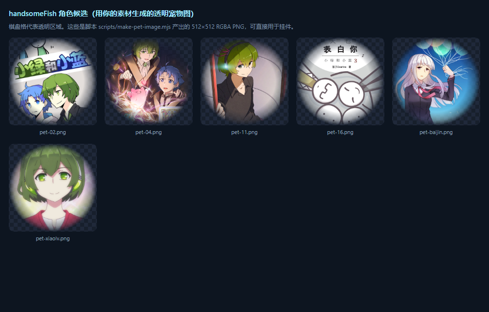

# 真·桌面级外壳

> 让帅鱼能放在**整个桌面的任意位置**——这是 DSH 界面内挂件做不到的：
> 界面内挂件是页面里的 DOM 元素，物理上出不了 DSH 窗口，窗口一最小化就看不见。

## 为什么一定要换载体

| | DSH 界面内挂件（已完成） | 桌面级外壳（本目录） |
|---|---|---|
| 载体 | DSH 页面里的 `position: fixed` 层 | 一块**铺满工作区的全透明置顶窗口** |
| 能放在哪 | 只能在这个 DSH 窗口内部 | 桌面任意位置（窗口内坐标自由） |
| 最小化 DSH 后 | 消失 | 仍在桌面上 |
| 会挡住别的程序吗 | 不会 | **会**，除非做点击穿透 —— 所以要有桥 |
| 角色本体 | `../lib/client.js` | **同一个文件，一行都不用改** |

## 三条实测出来的硬约束（都是踩过才知道的）

1. **Chromium 禁止 `file://` 页面 `fetch http://`** —— 桌面窗的前端**不能**自己轮询 DSH
   （实测报 `Failed to fetch`）。所以轮询放在**外壳的 Node 侧**（`turn-watch.js`），
   再把结果通过 IPC 推给页面。这是「桌面窗有没有结束音」的关键。
   顺带：客户端里有个 `__HANDSOME_FISH_NO_POLL__` 开关，桌面载体下会关掉前端自己的轮询，
   免得白试三次、白打三条报错。
2. **整页必须完全透明**。这一层只要有一点底色，就会变成一块盖住整个桌面的板子
   （自检里锁死了 `getComputedStyle(body).backgroundColor === "rgba(0, 0, 0, 0)"`）。
3. **默认必须点击穿透，且 `forward: true`**。少了 `forward`，窗口收不到鼠标移动事件，
   页面里的 `pointerenter` 永不触发，hover 状态就出不来 —— 挂件会变成"看得见点不着"。

## 已经做完并验证的部分

| 文件 | 作用 | 验证 |
|---|---|---|
| `renderer.html` | OS 级载体页：自带 `__ModuleLoader__` / `ctx` 桩，直接加载 `../lib/client.js`；并把用户素材接成默认角色 | 机读自检 **15/15** |
| `../lib/client.js` 的桥 | 上报「鼠标在不在角色上」（点击穿透）、接收外部推入的轮次事件 | 自检覆盖 hover 双向 + 轮次事件触发反应 |
| `turn-watch.js` | 轮次监视器：Node 侧轮询状态路由，检测 seq 递增 | `scripts/check.mjs` 单测 2 项（基线/递增/去重、失败退避） |
| `main.js` | 主进程：透明置顶无边框窗口、命中测试开关、轮次监视、退出 | 语法通过，运行时实测见下 |
| `preload.js` | `handsomeFishBridge`（桥）+ `handsomeFishTurns`（轮次）+ `handsomeFishConfig`（配置） | 语法通过 |

自检命令（不需要装 Electron，浏览器就能跑）：

```powershell
node scripts\selftest-desktop.mjs
```

（刻意用 `.mjs` 而不是 `.ps1`：Windows 默认执行策略会拦未签名的 PowerShell 脚本；
子进程的 stderr 也刻意接到文件描述符而不是管道，避开受限沙箱里带管道 stdio 的 EPERM。）

当前结果：

```
HF-SELFTEST OK pass=15 fail=0
PASS  client.js 已物化并 apply
PASS  桥收到 ready（carrier=desktop）
PASS  角色 DOM 存在
PASS  默认角色图已加载（用户素材接入桌面载体）  [../assets/pet-xiaolv.png → 实际 512x512]
PASS  挂件已切到自定义角色模式
PASS  鼠标进入角色 → 桥报 hover:true
PASS  鼠标离开角色 → 桥报 hover:false
PASS  台词气泡隐藏时不抢鼠标
PASS  台词气泡显示时可接收点击
PASS  桌面模式下菜单多出「退出挂件」
PASS  挂件层已注入
PASS  页面保持透明（不盖住桌面）
PASS  角色已定位在视口内
PASS  外壳推入轮次事件 → 角色做出反应
```

## 通道协议

**桥（页面 → 外壳）**

| 消息 | 外壳该做什么 |
|---|---|
| `{type:'ready', version, carrier}` | 复位为穿透姿态（热重载后可能残留上一条状态） |
| `{type:'hover', on:boolean}` | `on=true` → 关闭穿透；`on=false` → `setIgnoreMouseEvents(true, {forward:true})` |
| `{type:'quit'}` | 退出应用（菜单里的「退出挂件」按钮） |

**轮次（外壳 → 页面）**

| 消息 | 含义 |
|---|---|
| `handsome-fish:turn-end`（IPC） | 检测到新的一轮对话结束 → 页面派发同名 `window` 事件 → 客户端播结束音 + 冒泡 + 台词 |

**配置（外壳 → 页面）**

| 字段 | 来源 |
|---|---|
| `handsomeFishConfig.eventsUrl` | 三级解析：`DSH_WEB_URL` 环境变量 → `~/.dsh/mobile-access/setup.json` 的 `upstreamOrigin` → 空（降级为没有结束音） |

> 只读 host，**绝不去碰** `agents-anywhere/bridge/endpoint.json` 里的 token。

## 外壳选型：已选 Electron

| | **Electron**（已选） | WebView2 + WinForms（备选） |
|---|---|---|
| 运行时 | 需下载 electron ~110 MB（首次 `npm start` 时拉） | **零下载**：WebView2 运行时已装 `155.0.4283.45` |
| 编译工具 | 无需 | `csc.exe` 已在（.NET Framework `v4.0.30319`） |
| 额外依赖 | 无 | 需 2 个 NuGet DLL（约 1–2 MB） |
| 点击穿透 | `setIgnoreMouseEvents(true,{forward:true})` 一行 | `WS_EX_LAYERED \| WS_EX_TRANSPARENT` + 每帧命中测试 |
| 透明 | `transparent: true` 原生支持 | `CoreWebView2Controller.DefaultBackgroundColor = Transparent` |
| 置顶 | `setAlwaysOnTop(true,'screen-saver')` | `SetWindowPos(HWND_TOPMOST)` |
| 复用 `lib/client.js` | 100% | 100% |

选 Electron 的理由：点击穿透是这类挂件最容易翻车的地方，它有原生且经过验证的 API；
上游同类项目（`dsh-whale-desktop`）走的也是这条路。

## 怎么跑

```powershell
cd D:\Workspace\handsomeFish\desktop
npm start        # electron 已装好（44.7.2）；桌面上会出现角色，可拖到任意位置
```

拖到桌面任意位置；右键打开设置；菜单里有**「退出挂件」**。想开 DevTools：`npm start -- --devtools`。

### 本机实测踩到的四个启动坑（都已处理，换机器可能要重来）

1. **Chromium 沙箱会让 Electron 秒崩**（`STATUS_BREAKPOINT`，连 `--version` 都崩）。
   修复方式只能是**把 `--no-sandbox` 写在命令行上** —— 沙箱初始化发生在主进程加载
   `main.js` **之前**，所以在 `main.js` 里 `app.commandLine.appendSwitch` 已经来不及。
   `package.json` 的 `start` 脚本里已经带上它。
2. **这台机器的 npm 默认禁止安装脚本**（`install-scripts allowScripts`），所以
   `npm install` 不会自动解压 Electron 二进制。装完若没有
   `node_modules/electron/dist/electron.exe`，手动补一次：
   `cd node_modules/electron; node install.js`
3. **从 GitHub Releases 拉二进制会卡死**（实测 20 分钟零进展）。`desktop/.npmrc` 里
   已配好国内镜像；若手动装，先设环境变量：
   `$env:ELECTRON_MIRROR="https://npmmirror.com/mirrors/electron/"`
4. **Windows 上 Electron 是 GUI 子系统程序**：从没有控制台的父进程启动时，
   `console.log` 哪儿都不会出现。所以主进程的日志**同时写文件**：
   `desktop/handsome-fish.log`。出问题先看它。

> ⚠️ **未完成的一步：窗口本身没能在我这边实测。** DSH 的沙箱化启动上下文里，
> Electron 的主进程会卡在 `app.whenReady()` 之前（残留 3 个孤儿进程、日志停在启动那行），
> v40 与 v44 表现一致 —— 这是启动上下文限制，不是代码问题（DSH Desktop 自己就是
> Electron 44 且运行正常）。**请你在自己的终端里跑一次 `npm start`**，
> 然后看 `desktop/handsome-fish.log` 有没有越过 `ready-to-show`。

## 角色图：用你自己的素材

桌面外壳默认加载 `../assets/pet-xiaolv.png`（`renderer.html` 里的 `DEFAULT_ART`），
自检会断言它**真的解码成功**（`512x512`），所以改错路径会立刻被测出来。

- 换一张：改 `DEFAULT_ART`，或用 `npm start -- --art=...`（临时）
从搜集来的 18 张素材里挑出的可用候选：

| 文件 | 评价 |
|---|---|
| `assets/pet-xiaolv.png` | ✅ **最好**：单人、面部居中、柔边干净（当前默认） |
| `assets/pet-11.png` | ✅ 不错：绿发角色，可用作备选 |
| `assets/pet-baijin.png` | ⚠️ 一般：人物偏左、气球线干扰构图 |

> 一条可复用的经验：**素材必须是"单人插画"**。封面、群像、带标题文字的图裁成圆形后
> 一定会带进杂物和字（实测 02 / 04 / 16 就是这种，不可用，已删）。
> 想要真正的**全身**宠物形象，得先按 [../docs/character-spec.md](../docs/character-spec.md)
> 生成透明底全身立绘 —— 半身插画只能做出"柔边圆形头像"这种效果。



- 换一张：改 `DEFAULT_ART`，或用 `npm start -- --art=../assets/pet-11.png`
- 想用别处传进来的图：右键 → 「换个角色图」（存在 localStorage，优先级更高）
- 把普通插画转成透明宠物图：
  ```powershell
  node scripts\make-pet-image.mjs "_refs\xiaolan\09_baijin.png" "assets\pet-baijin.png" --focus "34% 26%"
  ```
  它用 headless Chrome 裁正方形 + 柔边圆形蒙版 + `--default-background-color=00000000`，
  直接产出带透明通道的 PNG，不需要任何图像库或抠图模型。


- 拖到桌面任意位置；右键打开设置；菜单里有**「退出挂件」**
- 想换角色图的其它方式：见上面「角色图」一节

## 已知待办

- [ ] 多显示器：当前只铺主显示器工作区；多屏需要按 `screen.getAllDisplays()` 每屏一个窗口
- [ ] 开机自启（快捷方式放进 `shell:startup`，或注册表 Run 项）
- [ ] 打包成单文件 exe（`electron-builder`），否则每次都要 `npm start`
- [ ] 位置持久化跨屏：现在存的是视口坐标，换显示器后位置可能需要重新摆
