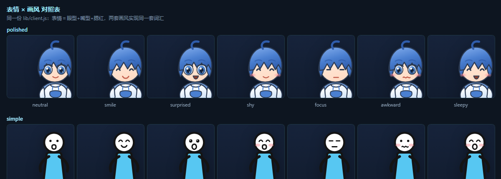

# 技术文档 · 架构与实现

> 面向维护者。回答三件事：**这东西是怎么跑起来的**、**改哪里会动到什么**、
> **哪些结论是实测的、哪些还只是推导**。
>
> 只想用起来看 [README.md](../README.md)；只想换角色看
> [xiaolan.md](xiaolan.md) 与 [asset-checklist.md](asset-checklist.md)。

---

## 0. 一页速览

**一个角色本体，两个载体。** 角色、交互、音效全部在 `lib/client.js` 里，
DSH 插件与独立桌面窗口都加载**同一个文件**，行为完全一致。

```
┌─ 载体 A：DSH 宿主进程（Electron 44 + cordis）────────────────────────────┐
│                                                                        │
│  lib/index.js（host 半边，cordis 插件）                                 │
│    ├─ ctx.on('session/event', …, {global:true})  ← 抓 turn/end          │
│    └─ ctx.inject(['webServer']) → webServer.register(GET /dsh-handsome-  │
│         fish/events.json)                                〔只读 JSON〕  │
│                                    ▲                                   │
│  dsh-client-modules 把 bundle 递给浏览器（/plugins 或 IPC fetchBundle） │
└────────────────────────────────────┼───────────────────────────────────┘
                                     │ ① 相对路径轮询（同源 http）
┌────────────────────────────────────┴───────────────────────────────────┐
│  浏览器 / Electron 渲染页                                                │
│    lib/client.js（client 半边，经典脚本）                                │
│      ├─ 注入 DOM：角色 + 气泡 + 菜单（#dsh-handsome-fish 层）            │
│      ├─ 拖拽/吸附/台词/音效（Web Audio 现场合成）                        │
│      └─ onTurnEnd() ←──┐                                               │
└────────────────────────┼───────────────────────────────────────────────┘
                         │ ② window 事件 'handsome-fish:turn-end'
┌─ 载体 B：独立桌面外壳（另一个 Electron 进程）──────────────────────────┐
│                                                                      │
│  desktop/main.js      全透明置顶窗口 + 命中测试开关                    │
│  desktop/preload.js   桥 / 轮次订阅 / 配置（contextIsolation）         │
│  desktop/turn-watch.js Node 侧轮询 /dsh-handsome-fish/events.json      │
│       └─ 检测到 seq 增长 → IPC → preload → 派发上面的 window 事件      │
│  desktop/renderer.html 加载同一个 lib/client.js                        │
└──────────────────────────────────────────────────────────────────────┘
```

**为什么轮次事件有两条路**：桌面外壳的页面是 `file://` 源，
而 Chromium **禁止 `file://` 页面 `fetch http://`**（实测 `Failed to fetch`），
所以那边把轮询搬到 Node 侧。详见 §5。

---

## 1. 运行时拓扑与文件职责

| 文件 | 运行环境 | 职责 | 改了怎么生效 |
|---|---|---|---|
| `lib/index.js` | DSH 宿主（Node/cordis） | 订阅 `session/event`、挂只读路由 | **必须重启 DSH** |
| `lib/client.js` | 浏览器 | 角色/交互/音效/台词，全部 UI | **Ctrl+F5** |
| `cordis.patch.yml` | 组合树配置 | 往组合树插一行 loader 条目 | 热生效（`patchReload: live`） |
| `package.json` | 包元数据 | 声明 bundle 与 client bundle 入口 | 装/卸时热生效 |
| `desktop/main.js` | 独立 Electron 主进程 | 窗口、命中测试、轮次轮询、日志落盘 | 重启桌面外壳 |
| `desktop/preload.js` | 渲染页隔离世界 | 桥、轮次订阅、配置注入 | 重启桌面外壳 |
| `desktop/turn-watch.js` | 同上（纯 Node 模块） | 轮次监视器，可脱离 Electron 单测 | 重启桌面外壳 |
| `desktop/renderer.html` | 桌面外壳渲染页 | 载体页：桩 + 桥 + 加载 `lib/client.js` | 重启桌面外壳 |
| `scripts/*.mjs` | Node | 自检与素材转换 | 直接跑 |

---

## 2. 插件的三处声明

DSH 认一个插件靠三样东西，缺一不可：

```jsonc
// ① package.json —— 声明「我是 bundle」+「我的浏览器半边在哪」
"exports": { "./client": "./lib/client.js" },   // client-modules 靠它找浏览器 bundle，缺了直接拒包
"dsh": {
  "bundle": { "patch": "./cordis.patch.yml" },
  "client": { "inject": [], "platform": "web" }  // platform 必须是 web
}
```
```yaml
# ② cordis.patch.yml —— 往组合树插一行（必须是顶层数组）
- insert:
    - id: handsome-fish
      name: 'dsh-handsome-fish'
```
```jsonc
// ③ profile 的 package.json —— 由 dsh plugin add 自动写入
"dsh": { "profile": { "bundles": [ …, "dsh-handsome-fish" ] } },
"dependencies": { "dsh-handsome-fish": "link:D:/Workspace/handsomeFish" }
```

`link:` 装出来是 **Junction（目录符号链接）**，不是拷贝 —— 所以改源码即时生效。
代价：源目录不能移动，挪了要重新 `dsh plugin --profile desktop add "link:<新路径>"`。

---

## 3. client 半边的硬约束

| 约束 | 原因 | 我们怎么保证 |
|---|---|---|
| **必须经典脚本**（`window.__ModuleLoader__.load({id, factory})`） | 写 ESM `export` 会让**整个 harness 启动失败**，不是"插件不生效" | `check.mjs` 用 `vm.Script()` 强制按经典脚本解析（比 `node --check` 严格） |
| 注册 id **必须等于包名** | 浏览器模块身份＝包名 | `check.mjs` 正则比对 |
| 只能 `require` 平台基座 | 平台只 seed React/cordis/静态 UI 库 | 本插件 `inject: []`，纯 DOM，不依赖任何平台模块 |
| 必须幂等 | 重复注入会叠出两个角色 | `if (document.getElementById(ROOT_ID)) return` |
| 必须自带顶层 try/catch | 插件崩了不能拖累宿主 | `apply()` 全程包裹 |
| 必须清理 | 卸载插件要回收 DOM/监听/定时器 | `ctx.on('dispose', destroy)` + `return destroy` |
| CSS 不能外泄 | 污染 DSH 或别的插件 | 所有规则都带 `#dsh-handsome-fish` 前缀 |
| 动画节点用完要 `remove()` | 长按拖动会无限累积 DOM | 所有 `element.animate()` 都挂 `onfinish` 清理 |

宿主要通过 `/plugins/<包名>/client.js` 提供**已构建**的产物；本插件手写就是这个形态，
**没有构建步骤**（没有 tsc/tsdown，改完直接生效）。

---

## 4. 平台 API 清单（都对着本机源码核实过）

| API | 签名 / 形状 | 用途 | 证据位置（本机 `@deepseek-ai/…`） |
|---|---|---|---|
| `session/event` | `(session, event) => void`，cordis **事件**（不是服务方法），**不需要 inject** | 抓 `turn/end` | `dsh-tool-cordis/lib/types/api-catalog.js:4131` |
| `turn/end` 载荷 | `data = { turn, reason }` —— **不带 usage、不带模型** | 判断一轮结束 | `api-catalog.js:6443`（`SessionEventMap`） |
| `reason` 枚举 | `completed·aborted·blocked·error·max-tokens·interrupted·forked` | 过滤簿记类结束 | `api-catalog.js:7655`（`TurnEndReasonMap`） |
| `{ global: true }` | `ctx.on(name, cb, {global:true})` 绕开 scope 过滤 | 收全所有会话的事件 | `dsh-cost-meter/lib/native-search-billing.js:358` |
| `webServer.register` | `register({kind:'exact'\|'prefix', path, handler}) → disposer`，handler 持有原生 `(req,res)` | 暴露只读状态 | `dsh-host-webserver/lib/index.js:177` |
| 服务等待 | `ctx.inject(['webServer'], webCtx => webCtx.effect(() => register(...), 'label'))` | webServer 缺席时静默跳过，不让插件 FAILED | `dsh-client-modules/lib/index.js:545-552` |
| 客户端 bundle 分发 | 服务端口提供 `/plugins`，Electron 外壳走 IPC `fetchBundle()` | 页面拿到 bundle | `dsh-client-modules/README.zh.md` |

> ⚠️ **不要**用 `ctx.get('sessions')` + `session.snapshotEvents()` 去轮询宿主状态：
> 那三个同步读取方法在当前版本**已被标记弃用**（禁止新增生产调用），
> 且大会话上物化整份事件数组很贵。

---

## 5. 状态同步：两条路，一个汇合点

### 5.1 载体 A（DSH 页面）：同源相对路径轮询

```js
// lib/client.js
var EVENTS_URL = window.__HANDSOME_FISH_EVENTS_URL__ || "/dsh-handsome-fish/events.json";
// 每 1.5s GET 一次；首次只记基线（不回放进程内已发生的历史轮次）
fetch(EVENTS_URL, { cache: "no-store" }).then(r => r.json()).then(d => {
  if (turn.seq < 0) { turn.seq = d.seq; return; }   // 基线
  if (d.seq > turn.seq) { turn.seq = d.seq; onTurnEnd(); }
});
// 连续失败 3 次就停（路由不存在时不要一直打请求）
```

页面 origin 就是宿主（外壳用 `loadURL(spec.url)` 加载渲染页），所以同源相对路径可用。

### 5.2 载体 B（桌面外壳）：Node 侧轮询 + IPC

`file://` 页面**发不出**跨协议请求，所以：

```
main.js（Node，无源限制）
  └─ turn-watch.js 每 1.5s GET 绝对地址（来自 DSH_WEB_URL / setup.json）
       └─ seq 增长 → webContents.send('handsome-fish:turn-end')
            └─ preload.js 里 ipcRenderer.on → 调页面注册的回调
                 └─ renderer.html 派发 window 事件 'handsome-fish:turn-end'
                      └─ lib/client.js 的监听器 → onTurnEnd()
```

客户端里用 `window.__HANDSOME_FISH_NO_POLL__` 关掉自己那条轮询（桌面载体设置它），
否则会白试三次并打三条报错。

### 5.3 汇合点与关键参数

两条路最终都调用同一个 `onTurnEnd()`：播结束音 + 随机台词 + 点头动画 + 冒泡。

| 参数 | 值 | 位置 | 为什么 |
|---|---|---|---|
| 轮询间隔 | 1500 ms | 两端 | 人类感知延迟可接受，开销可忽略 |
| 首次基线 | 只记不触发 | 两端 | 避免刚打开就补放历史轮次 |
| 宿主合并窗口 | 1200 ms | `lib/index.js` | 子代理收尾/多会话同时结束会连环响 |
| 静默原因 | `forked` / `interrupted` | `lib/index.js` | 簿记与崩溃恢复，不是用户感知的"一轮完成" |
| 失败退避 | 连续 3 次后停止 | 两端 | DSH 没在跑时别一直打请求打日志 |

---

## 6. 角色渲染架构

### 6.1 三档优先级

```
renderCharacter():
  artDataUrl = localStorage['dsh-handsome-fish:art']     ← ① 右键上传的图（最高）
             || window.__HANDSOME_FISH_DEFAULT_ART__     ← ② 载体指定的图（桌面 ?art=）
             || ""                                       ← ③ 内置程序化 SVG（默认）
  非空 → （.hf-art 浮动容器）
  空   → xiaolanSVG()（内联 SVG，部件级动画最全）
```

桌面外壳默认**不**给 ② —— 否则桌面上显示的角色会和插件里不一样
（这是实际踩过的坑，见 §9 第 12 条）。

### 6.2 舞台几何

| 项 | 值 | 说明 |
|---|---|---|
| 舞台基准 | **224×168 CSS px（4:3）** | SVG `viewBox` 为 `240×180`，同为 4:3 |
| 缩放 | 60%–160% | 设置菜单里的"大小" |
| 位置锚点 | `side`（left/right）+ `x`（离该侧边距）+ `y`（离底部边距） | 所以窗口缩放后角色仍贴在正确位置 |
| 吸附 | 水平方向总是吸到最近一侧；垂直方向只在靠近上下边时吸 | 关掉"边缘吸附"即可自由摆放 |
| 镜像 | 贴左侧时整体 `scaleX(-1)` | 所以角色素材只需出**一张朝左**的 |

### 6.3 画风切换（两种风格共用一套动画契约）


`state.style` 有两个值，`currentSVG()` 据此选角色定义：

| 值 | 角色定义 | 长什么样 |
|---|---|---|
| `simple`（**默认**） | `xiaolanSimpleSVG()` | 简笔画原作风：**无发的白圆头 + 点眼 + 小方嘴 + 蓝色长衫 + 粗黑线四肢** |
| `polished` | `xiaolanSVG()` | 精致描画：蓝发 + 呆毛 + 白/蓝卫衣 |

**关键设计：两份 SVG 刻意使用相同的部件类名**，于是 CSS 里那套关键帧与
`transform-origin` 完全复用 —— 实测 `getComputedStyle(.xl-arm-l).animationName` 在两种
画风下都是同一个 `hf-arml`，**没有为第二种画风新增任何动画代码**。

要做到这一点有两个纪律：

1. **部件语义要对齐**：简笔画的躯干也叫 `.xl-torso`，眼睛也叫 `.hf-eye`，浮动容器也叫 `.hf-bob`。
2. **关节朝向要对齐**：`.xl-arm-l` 的 `transform-origin: 82% 8%` 是"包围盒右上角"，
   所以简笔画的左臂也必须画成**肩在右上、手在左下**，这个百分比才正好落在肩关节上。

样式切换走菜单里的 `<select data-k="style">`；`onMenuInput` 对 `SELECT` 单独取值
（枚举值是字符串，不能走数值 clamp，否则会被当成 `NaN` 丢掉），改完调 `renderCharacter()`。

调试用：`?style=simple|polished` 只是**初始默认**（写进 `DEFAULTS.style`），
用户在菜单里改过就以用户的选择为准；`window.__HANDSOME_FISH__.redraw()` 可手动重绘。

#### ⚠️ 「代码默认值」必须与「用户显式选择」分开

`writeStore()` 会把 `DEFAULTS` 的每一项都写进 localStorage。于是第一版有个隐蔽的坑：
**用户只要打开过一次菜单，当时的默认画风就被存盘了**，此后改代码里的默认值
（`carrierStyle()` 的返回值）对已有存档的 profile **完全无效** ——
症状就是"改了默认画风，重启后还是旧角色"。

解法是加一个 `stylePinned` 标记：

- `readStore()`：读到 `stylePinned !== true` 的**旧存档**时，**忽略存档里的 `style`**、
  改用当前代码默认（一次性迁移）；其它偏好（大小/音量/位置）照常保留
- 用户在菜单里显式选过画风后 → `stylePinned = true` 并写盘，从此不再被代码默认值覆盖

回归测试：`scripts/fixtures/store-migration-test.html`，已接进 `scripts/selftest-desktop.mjs`
的**第二步**（第一步是桌面载体自检）。它造一份「有 `style:polished`、无标记、`size:1.3`」的
旧存档，期望得到 `style=simple` 且 `size` 仍为 `1.3`。实测输出：

```text
HF-MIG style=simple size=1.3 volume=0.25
HF-MIG verdict=PASS
```

> 顺带修掉一个隐患：自检原先跑在**默认浏览器 profile** 上，而桌面外壳与 preview 都是
> `file://` 源、**共用同一份 localStorage** —— 自检里的 `setArt("")` 会清掉用户真实存的
> 角色图。现在自检统一加 `--user-data-dir=<临时目录>`，跑完即删，**测试不碰用户设置**。

### 6.4 部件级动画（换角色时按这张表挂）

| 类名 | 部件 | 内置动画 |
|---|---|---|
| `.hf-bob` | 整体浮动容器 | 上下浮 7px |
| `.xl-ahoge` | 呆毛 | 左右摆动（小蓝的标志性待机动作） |
| `.xl-arm-l` / `.xl-arm-r` | 左右手臂 | 轻微反向晃 |
| `.xl-torso` | 躯干 | 呼吸缩放 |
| `.hf-eye` | 眼睛 | 定时眨眼 |
| `.hf-shadow` | 地面投影 | 随浮动明暗 + 横向缩放 |
| `.hf-bubbles` | 灵感火花层（JS 生成） | 点击时冒泡 |

配色改 `<defs>` 里五个渐变即可；把 `xl-hoodie` 调白、`xl-hood` 调浅就是白大褂版。

### 6.5 音效：Web Audio 现场合成

四种音效（气泡/结束音/提醒/落地）全部用振荡器 + 指数包络合成，**没有任何音频文件**。
好处：零体积、零版权、零网络请求，并顺带绕开「IDM/迅雷等下载管理器把挂件音频请求
当下载任务抢走」这个已知坑。

浏览器自动播放策略要求首次用户手势后才能出声 —— 首次左键点角色或右键开菜单时会
自动 `resume()`。

### 6.6 持久化

| 键 | 内容 |
|---|---|
| `localStorage['dsh-handsome-fish:v1']` | 设置 JSON：大小/音量/静音/**画风**/台词/吸附/结束音/隐藏/位置锚点 + `stylePinned`（用户是否显式选过画风，见 §6.3） |
| `localStorage['dsh-handsome-fish:art']` | 自定义角色图的 base64 data URL（单独存，免得把设置文件撑爆） |

---

### 6.7 表情系统（眼型 × 嘴型 × 腮红）



词汇取自 `_refs/xiaolan/` 下「风格-成熟」与「风格-简笔」两个目录里按情绪命名的参考图。
一个表情 = **眼型 + 嘴型 + 是否腮红**；两种画风各自实现同一套词汇，
所以换画风时表情语义不变（`smile` 在两边都是"笑眼 + 上扬嘴"）。

| 表情 | 眼型 | 嘴型 | 腮红 | 用在哪 |
|---|---|---|---|---|
| `neutral` 平常 | `plain` 点眼 / 瞳眼 | `small` 小方嘴 | — | 静息 |
| `smile` 莞尔 | `arc` ∩ 笑眼 | `smile` 上扬 | — | 首次出现 |
| `surprised` 吃惊 | `wide` 放大 | `open` 张嘴 | — | 拖动中 |
| `shy` 害羞 | `arc` | `small` | ✓ | 被点击 |
| `focus` 认真 | `line` 平直 | `flat` 直线 | — | 一轮对话结束 |
| `awkward` 尴尬 | `plain` | `wavy` 波浪 | ✓ | 松手落位 |
| `sleepy` 打哈欠 | `arc` | `open` | ✓ | 空闲久了（与平常轮换） |

状态 → 表情的映射集中在 `STATE_EXPRESSION` 一张表里，改行为只改这张表；
临时表情带 `holdMs`，到点自动回到"静息表情"（`restingExpression`）。

**关键约束：换表情只替换 `<g class="hf-face">` 的 innerHTML，绝不重建角色。**
重建会让正在跑的 CSS 动画（浮动/摆臂/眨眼）从头开始，视觉上"跳"一下。
自检里有三条专门盯这个：换表情后面部内容要变、`.hf-face` 必须还是同一个 DOM 节点、
且 `.xl-arm-l` 的 `animationName` 仍在跑。

> 表情与画风是**正交的两维**：`state.style` 决定"用哪套 SVG"，`expression` 决定
> "脸上画什么"。所以 7 种表情 × 2 种画风 = 14 种组合，而代码里只有两处小型五官构造器。

### 6.8 作者原画（本地素材包，按状态换图）

手写 SVG 只是**近似**作者画风。要做到"就是作者的画"，只能用作者自己的像素。
但作者的参考图是**第三方素材、不随仓库分发**，于是设计成这样：

| 环节 | 做法 |
|---|---|
| 素材从哪来 | 用户的 `assets/`（`.gitignore`）。用 `scripts/cutout-pet.mjs` 从参考图抠出透明 PNG |
| 怎么供给页面 | **DSH 页面**：主机侧前缀路由 `/dsh-handsome-fish/art/`（http 页面读不到 `file://`）<br>**桌面外壳**：`preload.js` 用 Node 读清单后注入（`file://` 下 `fetch` 本地 json 会被 Chromium 拦） |
| 用哪张 | `assets/art-manifest.json`：`{ default, states: { 状态: 文件名 } }` |
| 拿不到时 | **静默退回内置 SVG** —— 全新克隆里 `assets/` 是空的，挂件照常可用 |

优先级：**上传/指定的图（`?art=`）> 清单里的状态原画 > 内置 SVG**。

换状态时只改 `` 的 `src`（`updateArtImage()`），**不重建角色** —— 与 §6.7 同一条纪律：
重建会打断 `.hf-art` 的容器级浮动动画。全部图片在启动时预解码，切状态不会闪白。

主机侧路由有两道防穿越锁：文件名必须匹配"纯文件名"正则（挡掉 `../` 与盘符），
且 `resolve` 后的绝对路径必须仍在素材目录内。`scripts/check.mjs` 里对发图、404、415、
405 与三种编码变形的穿越各有一条断言。

### 6.9 抠图：`scripts/cutout-pet.mjs`

参考图大多是"纯白底 + 角色"，但**不能简单地"把白色变透明"** ——
简笔画风格里**角色的头也是白的**，那样会把头掏空。正确做法是**从图像四边 flood fill**：
只有与边缘**连通的**白才算背景，被黑描边围住的内部白色会被保住。

两个实现要点：

1. 源图以 **data URL** 内嵌进页面 —— `file://` 页面里画 `file://` 图会让 canvas 被污染，
   `getImageData` 抛 `SecurityError`；data URL 不算跨源。
2. 像素处理在页面的 canvas 里做，结果用 `--default-background-color=00000000` 截图导出 ——
   省掉"几百 KB base64 从浏览器塞回 Node"这个脆弱环节。

判定抠得对不对的办法不是肉眼看，而是**扫多个阈值看包围盒稳不稳**：
实测 `215/232/250` 三档下角色包围盒是 `295×552 / 296×554 / 299×556`，
几乎不变 —— 说明没有漏进角色内部（真漏了 bbox 会暴涨）。

已知限制：**全幅插画没有白底就抠不出来**（`成熟的蓝.jpg`、`蓝的认真工作.jpg` 实测只清掉 0～0.4%），
这类图需要人工蒙版或 AI 抠图；全身立绘放进 4:3 舞台会又瘦又小，适合用半身/头像构图。

## 7. 桌面外壳（`desktop/`）

### 7.1 窗口参数与理由

| 参数 | 值 | 为什么 |
|---|---|---|
| `transparent` + `frame:false` + `backgroundColor:'#00000000'` | 开 | 桌面上只能看到角色本身 |
| 尺寸 | 主显示器 **workArea**（排除任务栏） | 铺满整屏但不会跑到任务栏底下 |
| `alwaysOnTop(true, 'screen-saver')` | 最高层级 | 尽量盖住全屏应用 |
| `skipTaskbar: true` | 开 | 桌宠不该出现在任务栏/Alt-Tab |
| `backgroundThrottling: false` | 开 | 窗口没焦点时动画不能僵住 |
| `show:false` → `showInactive()` | — | 启动时不抢当前窗口焦点 |

### 7.2 点击穿透协议（桥）

整块窗口默认穿透，否则会挡住下面**所有**程序的点击。判断"鼠标在不在角色上"只能由
页面做（它知道 DOM 布局），所以约定三个消息：

| 消息 | 方向 | 外壳动作 |
|---|---|---|
| `{type:'ready', version, carrier}` | 页面 → 外壳 | 复位为穿透姿态 |
| `{type:'hover', on:boolean}` | 页面 → 外壳 | `on=true` → `setIgnoreMouseEvents(false)`；`false` → `setIgnoreMouseEvents(true, {forward:true})` |
| `{type:'quit'}` | 页面 → 外壳 | 退出应用（菜单里的「退出挂件」） |

`forward: true` 是**必需项**：否则窗口不接收鼠标移动，页面里的 `pointerenter`
永不触发，hover 状态永远出不来 —— 挂件会变成"看得见点不着"。

角色、台词气泡、设置菜单、隐藏后的边缘小标签，四个区域都会上报 hover
（气泡**隐藏时** `pointer-events:none`，否则它会变成一块看不见的挡板）。

### 7.3 轮次通道

见 §5.2。`turn-watch.js` 刻意做成**不依赖 Electron 的纯 Node 模块**：
于是它能在 `scripts/check.mjs` 里被直接单测（注入假 `fetch` 和假定时器），
不用把桌面窗口真的跑起来。

### 7.4 日志为什么落盘

Windows 上 Electron 是 **GUI 子系统**程序：从没有控制台的父进程（计划任务、
后台任务、双击 exe）启动时，`console.log` **哪儿都不会出现**。
所以主进程把日志同时写进 `desktop/handsome-fish.log`（启动、窗口创建、
`ready-to-show`、页面加载失败、渲染进程终止、桥就绪、轮次基线）。

---

## 8. 验证体系（三层，各管一段）

| 层 | 工具 | 覆盖 | 不覆盖 |
|---|---|---|---|
| **静态 + 逻辑** | `node scripts/check.mjs`（16 项，纯 Node） | 包元数据/经典脚本约束/注册 id；host 半侧端到端（桩 ctx 跑通 `turn/end` → 计数 → 路由，含合并窗口与静默原因）；轮次监视器单测；文档相对链接可达 | DOM、渲染、真实宿主 |
| **载体自检** | `node scripts/selftest-desktop.mjs`（15 项，headless 浏览器） | 桥双向、点击穿透协议、内置 SVG 与 `?art=` 两条角色路径、隐藏气泡不抢鼠标、页面透明、轮次事件能触发反应 | 真实窗口的透明/置顶/穿透手感 |
| **人眼 + 截图** | `preview.html` + headless Chrome | 外观、气泡排版、镜像、菜单 | 自动化断言 |

设计原则：**把"能静态查的"和"必须跑起来才知道的"分开**，
并且**验证工具自身要可靠** —— `selftest-desktop.mjs` 对 headless Chrome
偶发空输出做了重试（实测遇到过：并发跑两个 Chrome 时自检抓到 0 行而误报失败）。

`preview.html` 的三个调试开关值得记住：

| 开关 | 作用 |
|---|---|
| `?freeze=1` | 关掉过渡与动画 —— headless 的 virtual-time 会把 CSS 过渡**冻结在半路**，截图里出现"气泡半透明、颜色偏淡"的假象 |
| `?debug=1` | 几何读数浮层（用真实 `getBoundingClientRect` 代替心算定位） |
| `?bare=1` | 隐藏调试用假界面，出干净展示图 |

`#menu` / `#noshades` / `#say` / `#left` / `#custom` / `#big` 可直接跳到某个状态截图。

---

## 9. 踩坑清单（全部实测，附发现方式）

| # | 坑 | 现象 / 根因 | 解法 |
|---|---|---|---|
| 1 | client bundle 写 ESM `export` | **整个 harness 启动失败**（不是插件不生效） | 经典脚本注册；`vm.Script` 静态拦截 |
| 2 | `file:` 安装是复制不是链接 | 改源码运行无变化 | 用 `link:`（Junction） |
| 3 | 新增 bundle 是否要重启 | **不用** —— `dsh plugin add` 后 host 路由与 client 挂件都热生效了 | 但 **host 代码**改动仍必须重启（实测新加字段一直没出现） |
| 4 | `file://` 页面 `fetch http://` | `Failed to fetch`（Chromium 禁止跨协议） | 桌面载体的轮询搬到 Node 侧 + IPC |
| 5 | Electron 秒崩 `STATUS_BREAKPOINT` | Chromium 沙箱初始化失败；**崩在 main.js 加载之前** | `--no-sandbox` 必须写在**命令行**上（`app.commandLine.appendSwitch` 来不及） |
| 6 | npm 默认禁止安装脚本 | `install-scripts … blocked`，Electron 二进制从没解压 | `cd node_modules/electron && node install.js` |
| 7 | GitHub 拉 electron 二进制卡死 | 20 分钟零进展 | `ELECTRON_MIRROR=https://npmmirror.com/mirrors/electron/`（9 秒下完） |
| 8 | GUI 子系统 stdout 不可见 | 主进程日志"消失"，排查全靠猜 | 日志落盘到 `desktop/handsome-fish.log` |
| 9 | headless 截图里过渡冻结在半路 | 看起来像样式 bug | `?freeze=1` 关动效再截图 |
| 10 | 图片异步解码 | 断言在加载完成前检查 → 误报 `0x0 加载失败` | `await img.decode()` 再断言 |
| 11 | 并发 headless Chrome 偶发空输出 | 自检抓到 0 行 → 误报失败 | 自检内置一次重试 |
| 12 | 给桌面载体写死默认角色图 | 桌面显示素材图、插件显示小蓝，**两边角色不一致** | 默认不覆盖；`?art=` 才是显式替换 |
| 13 | 台词气泡隐藏时仍 `pointer-events:auto` | 在桌面窗口里变成一块**看不见的挡板**，吃掉整片桌面点击 | 只有 `.is-on` 时才接收鼠标 |
| 14 | Chromium localStorage 落盘延迟 | 刚改完的设置从 LevelDB 里搜不到（`000121.log` 为 0 字节） | 别用它做即时验证；等落盘或从页面里读 |
| 15 | 受限启动上下文里 Electron 起不来 | 主进程停在 `app.whenReady()` 之前，残留孤儿进程；v40/v44 一致 | **属本会话边界**：请在普通终端里跑 `npm start`（DSH Desktop 自己就是 Electron 44 且正常） |

---

## 10. 维护指引：常见改动怎么做

| 想改 | 动哪里 | 生效方式 | 别忘了 |
|---|---|---|---|
| 台词 | `lib/client.js` 的 `LINES` 六池 | Ctrl+F5 | 单条尽量 ≤12 字（气泡最宽 `min(230px,58vw)`） |
| 角色形象（程序化） | `lib/client.js` 的 `xiaolanSVG()` / `xiaolanSimpleSVG()` + `<defs>` 渐变 | Ctrl+F5 | 部件动画类名见 §6.4；两套画风必须保持部件类名与关节朝向一致（§6.3） |
| 角色图（素材） | 右键上传，或 `?art=` | 即时 | 画布用 **4:3**（见 [asset-checklist.md](asset-checklist.md) 2.2） |
| 音效 | `createAudio()` 里的 `pop/chime/ding/thud` | Ctrl+F5 | 全部是合成，不要引入音频文件 |
| 加大小的上下限 | `DEFAULTS.size` 的 clamp 与菜单 `input` 的 min/max | Ctrl+F5 | 舞台几何是 224×168，放大 160% 时素材要够清晰 |
| 加一个宿主状态 | `lib/index.js` 的载荷 + 客户端解析 | **重启 DSH** | 载荷字段是白名单，`check.mjs` 会校验 |
| 换宿主事件的种类 | `lib/index.js` 的 `session/event` 分支 | 重启 DSH | `turn/end` 的 data 只有 `{turn, reason}`；模型与 usage 在 `assistant/message` |
| 桌面外壳窗口行为 | `desktop/main.js` 的 `BrowserWindow` 参数 | 重启外壳 | 改完先看 `handsome-fish.log` |

### 发布前检查清单

1. `node scripts/check.mjs` → 全过
2. `node scripts/selftest-desktop.mjs` → 全过
3. 在真实 DSH 里 Ctrl+F5，确认角色/菜单/台词/结束音
4. `dsh --profile desktop --dump-config | Select-String handsome` → 组合树里有它
5. `git status` 干净；确认 `node_modules/`、`_refs/`、日志、`_shots/` **都没进库**
6. 如果角色素材来自第三方作品：**不要随包分发**（见下）

---

## 11. 边界与未验证项（诚实清单）

| 项 | 状态 |
|---|---|
| DSH 插件在活宿主里的路由与轮次计数 | ✅ 实测（`curl` 拿到自己的载荷，`seq` 随对话增长） |
| 插件在活 GUI 里渲染、交互、设置持久化 | ✅ 实测（用户截图确认） |
| 桌面载体的桥/角色/透明/轮次事件 | ✅ headless 自检 15/15（含真跑一次自检 3 次确认稳定） |
| 轮次监视器逻辑 | ✅ 单测（基线/递增/去重/失败退避） |
| **桌面窗口真的飘在桌面上**（透明、置顶、穿透手感） | ❌ **未验证** —— 本会话的启动上下文起不来 Electron（§9 第 15 条），需在普通终端跑一次 |
| 多显示器 | ❌ 未实现（当前只铺主显示器 workArea） |
| 开机自启 / 打包成 exe / 托盘图标 | ❌ 未实现（素材规格见 [asset-checklist.md](asset-checklist.md) 三） |
| 素材的 4:3 比例结论 | ⚠️ 由 CSS/DOM 推导，**尚未像素实测**（做法见 [asset-checklist.md](asset-checklist.md) 附） |
| 角色 IP | ⚠️ 默认形象是手写 SVG 的**小蓝**（《小绿和小蓝》，笛子Ocarina）。自用没问题；**公开发布/分发前需自行确认授权**。`_refs/` 里的第三方插图已在 `.gitignore` 中排除 |

---

## 12. 相关文档

| 文档 | 内容 |
|---|---|
| [../README.md](../README.md) | 总览、功能、实现原理入门、开发工作流 |
| [xiaolan.md](xiaolan.md) | 目标角色的权威设定考证、图源陷阱、三条产出路线 |
| [asset-checklist.md](asset-checklist.md) | 素材规格（4:3 / 透明度 / 体积 / 分辨率）、图标类素材、验收清单 |
| [character-spec.md](character-spec.md) | AI 生图提示词（三套风格 + 负面词）与抠图后处理步骤 |
| [../desktop/README.md](../desktop/README.md) | 桌面外壳的进展、桥协议、启动坑 |
